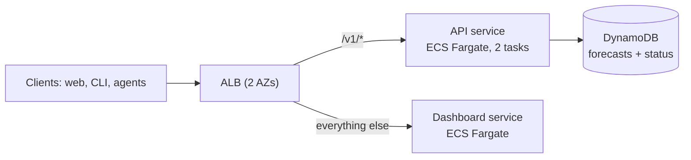
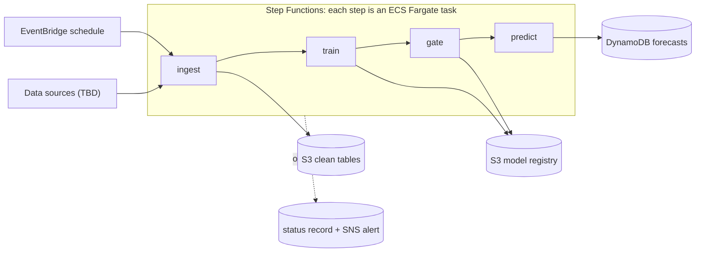

# Carbon windows

Find the lowest-emission time to run a heavy job. An API serves precomputed forecasts, and a
dashboard, a CLI and a coding-agent skill all read from it.

This is a club project (10 weeks, demo only). **The data and the model are stubs**: ingest
generates a synthetic series and the models are simple baselines. Everything around them (API,
CLI, dashboard, pipeline, infrastructure) is real and works with the stubs, so the real data and
model drop in later without touching the rest.

## Architecture

**A. Serving.** An ALB spans two AZs and routes `/v1/*` to the API and everything else to the
dashboard, both ECS Fargate services. The API only reads precomputed forecasts; no ML runs at
request time.



**B. Training.** EventBridge starts a Step Functions workflow. Each step is an ECS Fargate task
running the same image with a different command. A failure anywhere is written to the status
record (which the API turns into a warning) and sent to SNS.



## Try it locally (no AWS)

```bash
pip install -e ".[cli,dashboard,dev]"
make seed        # run ingest -> train -> gate -> predict with stub data
make api         # http://localhost:8000/docs
carbon-windows best --duration 4 --max-wait 1d
make dashboard   # http://localhost:8501 (in another terminal, with the API running)
make test
```

Or with Docker: `docker compose run --rm pipeline && docker compose up --build`.
State is kept as JSON files in `.local/`. If you build the image on Apple silicon for AWS, use
`--platform linux/amd64`.

## Repo layout

```
src/carbon/
  api/        FastAPI app: /v1/forecast, /v1/windows, /v1/health
  jobs/       ingest, train, gate, predict, accuracy, pipeline (local runner)
  model/      the Model interface + baseline models + registry
  common/     config-driven storage, window search, validation, time helpers
  cli/        Typer CLI
dashboard/    Streamlit app (talks to the API only)
skills/       agent skill (SKILL.md) for the CLI
fixtures/     example API responses, generated from the real code (make fixtures)
infra/        Terraform: bootstrap, base, serving, training, freeplan-check
scripts/      deploy.sh, tf.sh, run_pipeline.sh, make_fixtures.py
docs/         runbook (bring up, demo, tear down)
```

## Swapping in the real data and model

| Task | Where | Notes |
|------|-------|-------|
| Real data sources | `jobs/ingest.py`, `fetch_raw()` | The only code that knows where data comes from. Keep the output shape (hourly UTC values) and the `validate_series` call. |
| A real model | `model/`, implement `Model`, add it to `registry.py`, set `CARBON_MODEL` | `fit(history)` and `predict(history, horizon)`; return p10/p50/p90. Nothing else changes. |
| Locations, history, horizon, refresh, thresholds | environment variables, see `config.py` | Terraform exposes the main ones as variables. |

The forecast shape (hourly rows with `intensity`, `p10`, `p90`) is the contract the API,
dashboard and CLI depend on. If the real data changes the granularity, update `jobs/predict.py`
and `api/main.py` together.

## API

| Endpoint | Purpose |
|----------|---------|
| `GET /v1/forecast?location=&hours=` | Hourly predicted intensity with a p10-p90 range. |
| `GET /v1/windows?duration_hours=&max_wait=&deadline=&location=&top=` | Best windows, a `run_now` / `delay` recommendation, and savings at several wait limits. |
| `GET /v1/health` | Pipeline status and forecast age. Always returns 200 so the load balancer does not cycle tasks. |

`max_wait` (`90m`, `3h`, `1d`) is the longest delay you accept; `deadline` (ISO time) is when the job
must finish. Use one or neither. Interactive docs are at `/docs`. Example responses are in `fixtures/`.

**Warnings.** Every response carries a `warnings` list:

| Code | Meaning |
|------|---------|
| `pipeline_failed` | The last pipeline run failed. The last good forecast is still being served. |
| `forecast_stale` | The forecast is older than `CARBON_STALE_AFTER_HOURS` (the pipeline has stopped running). |
| `model_fallback` | The champion model could not be loaded, so the baseline was used. |
| `data_quality_degraded` | Many input hours were imputed. |
| `wait_clamped_to_horizon` | The requested wait was longer than the forecast covers. |

Errors are `{"error": {"code", "message"}}`: `404 unsupported_location`, `503 no_forecast`,
`503 forecast_expired`, `422` for bad parameters.

## CLI and agent skill

```bash
export CARBON_API_URL=http://<alb-dns>   # default http://localhost:8000
carbon-windows best -d 4 -w 1d           # table
carbon-windows best -d 4 -w 1d --json    # for agents
carbon-windows forecast --hours 24
carbon-windows status
```

Exit codes: `0` ok, `2` bad arguments, `3` API unreachable, `4` data returned but stale or the
pipeline failed (`--allow-stale` ignores this), `5` API error.

To give a coding agent the skill, copy `skills/carbon-windows/` into the agent's skills directory.

## Model rollout

New models go through a gate: a freshly trained model is promoted to champion only if it is no
worse than the current champion on the most recent held-out hours. That is the only rollout
mechanism (no traffic splitting). Optionally set `CARBON_SHADOW=1` to also write the newest
candidate's forecasts under its own version tag without serving them; the hourly accuracy job
scores both against actuals as they arrive.

Limits of the stub gate: the champion's holdout score is computed on data it may have seen. Use a
proper rolling-origin backtest once the real model exists.

## Deploying to AWS

See [docs/runbook.md](docs/runbook.md). Short version:

1. Use the region your AWS project allows (default `us-east-2`). AWS blocks workloads in other regions.
2. Check the account allows ECS Fargate and ALBs (`infra/freeplan-check`).
3. Apply `infra/bootstrap` once for the state bucket, set `TF_STATE_BUCKET`, then run `scripts/deploy.sh up`.

The Free plan's managed policy blocks GitHub OIDC, so the default path deploys from one machine.
The GitHub workflows are included for accounts where OIDC is allowed.

Cost: the ALB bills by the hour even with no tasks, and an ALB plus a few small Fargate tasks is
roughly $0.06-0.08 per hour (check the AWS pricing calculator). Run `scripts/deploy.sh down-serving`
whenever you stop working, and `down-all` after the demo.

## What has and has not been verified

- Python code: 49 tests pass (window search, validation, models, pipeline, failure handling, API,
  CLI, and the AWS storage path against fake AWS via `moto`), and the dashboard was run headlessly
  against a live API.
- Terraform and workflows: formatted, syntax-checked and cross-reference-checked, **but never applied**.
  `terraform validate` and a real apply still need to happen on a machine with registry and AWS
  access. Expect to fix small things on the first apply; the CI workflow runs `validate` for you.
